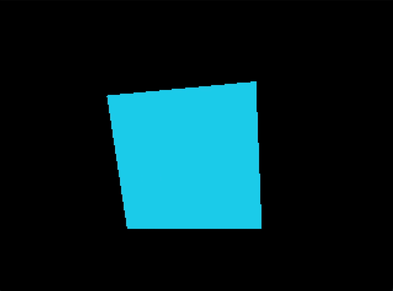

# Flutter Software Renderer

A small CPU-based 3D software renderer hosted by Flutter. The app loads a
Wavefront OBJ mesh and renders it into an engine-owned RGBA framebuffer; Flutter
converts each completed frame to an image and presents it with nearest-neighbor
scaling.

The animation below shows the earlier cube depth-buffer demo; the app now loads
the OBJ model described below.



## Rendering pipeline

- `ModelViewDemo` loads indexed triangle geometry from an OBJ asset, normalizes
  it with `Mesh.normalized()`, and animates its transform.
- The `Camera` hierarchy (`PerspectiveCamera` today) and `MeshPipeline` project
  vertices to framebuffer coordinates and normalized depth.
- `Renderer.drawMesh` submits projected triangles to the CPU triangle rasterizer.
- A per-pixel depth buffer ensures nearer fragments occlude farther surfaces.
- `Engine` clears both buffers per frame and handles asynchronous conversion
  and presentation of framebuffer pixels as a Flutter image. It waits for game
  initialization before requesting the first frame.

The current renderer rasterizes triangles into color and depth buffers. It does
not yet display OBJ materials or textures, calculate lighting, or clip
triangles crossing the camera's near plane; faces outside the depth range are
skipped for now.

## Run

```sh
flutter run
```

## Test

```sh
flutter test
flutter analyze
```

## Packages

The engine lives in `packages/software_engine` (pure Dart) and the Flutter host in `packages/software_engine_flutter`. The app depends on both through path dependencies.

```sh
cd packages/software_engine
dart analyze
dart test
```

```sh
cd packages/software_engine_flutter
flutter analyze
flutter test
```

## Benchmarks

Run from `packages/software_engine`, using AOT builds (JIT numbers are for development only):

```sh
dart compile exe benchmark/run_all.dart -o /tmp/run_all
/tmp/run_all --machine="<CPU>, <OS>, Dart <version>"
```

The run writes `benchmark/results/run_all.json` (git-ignored). Copy a result to `benchmark/baselines/` to record a baseline.
